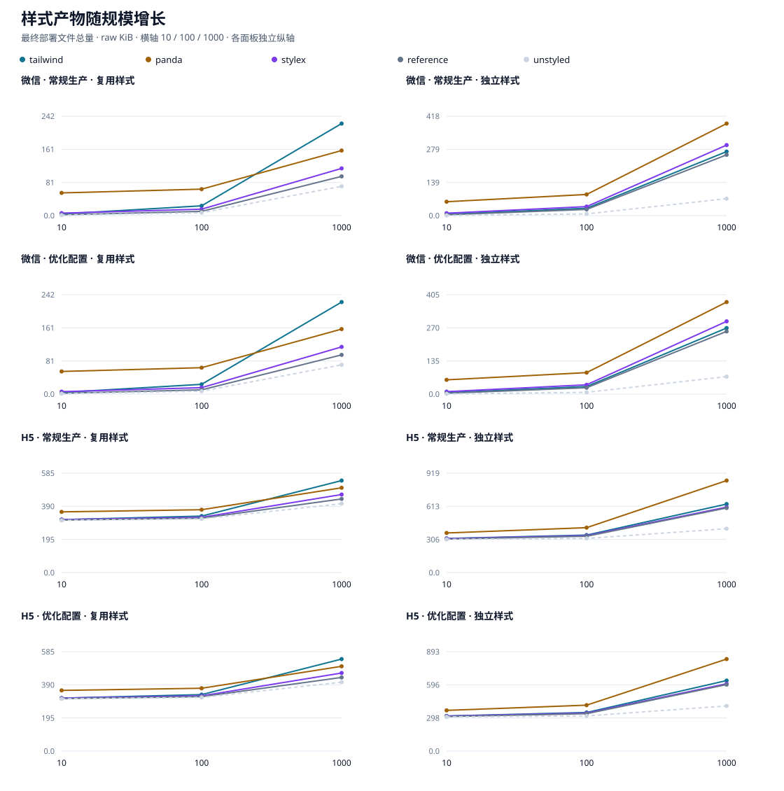
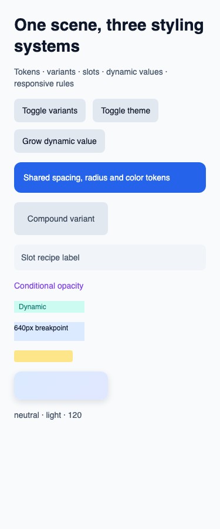
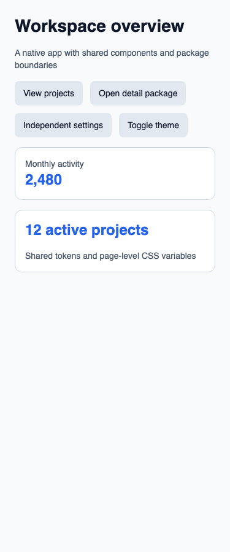
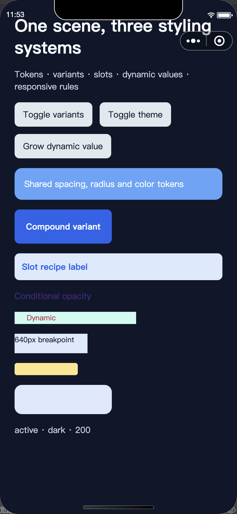

# 小程序样式方案产物体积对比

对比 weapp-tailwindcss、weapp-pandacss、weapp-stylex 在原生微信小程序与 H5 中实现相同布局和交互状态的最终产物体积，同时保留手写 CSS 参考和无样式基线。数据由真实生产构建生成，README 表格与曲线均来自同一份报告。

## 本次结论

- 微信的业务应用场景，常规生产下总产物最小为 **weapp-tailwindcss：20.73 KiB**；三方案最大与最小相差 104.98 KiB。
- 微信的业务应用场景，优化配置下总产物最小为 **weapp-tailwindcss：20.73 KiB**；三方案最大与最小相差 104.13 KiB。
- H5的业务应用场景，常规生产下总产物最小为 **weapp-stylex：347.10 KiB**；三方案最大与最小相差 65.44 KiB。 raw 排序前两方案相差 108 字节（相对最小值 0.030%）；此差值只代表本版本和场景，不能泛化为普遍优势。
- H5 常规生产的业务应用传输参考：gzip 最小为 **weapp-tailwindcss 104.96 KiB**（与 raw 最小方案不同）；Brotli 最小为 **weapp-tailwindcss 88.31 KiB**（与 raw 最小方案不同）。raw 与压缩的排序取决于字符串、声明和代码的可压缩性，应按实际交付方式选指标。
- H5的业务应用场景，优化配置下总产物最小为 **weapp-stylex：347.10 KiB**；三方案最大与最小相差 64.17 KiB。 raw 排序前两方案相差 108 字节（相对最小值 0.030%）；此差值只代表本版本和场景，不能泛化为普遍优势。
- H5 优化配置的业务应用传输参考：gzip 最小为 **weapp-tailwindcss 104.96 KiB**（与 raw 最小方案不同）；Brotli 最小为 **weapp-tailwindcss 88.31 KiB**（与 raw 最小方案不同）。raw 与压缩的排序取决于字符串、声明和代码的可压缩性，应按实际交付方式选指标。
- Panda 类名哈希优化在四个展示/业务应用组合中的总产物变化范围为 0.71～1.41 KiB；相对降幅最大为 微信 gallery 的 1.11%。负值表示优化配置体积增加，详见下表。
- 规模由 10 增至 1000，三方案各目标/配置的总量增长：复用场景 103.19～229.84 KiB，独立样式场景 263.57～484.58 KiB。增长同时包含节点、模板和绑定数据，不能全归为样式增长。
- gallery/application 共 8 个目标/配置/场景组合中，样式最小方案与总量最小方案全部一致；完整分项仍需一起比较。gallery 是较小能力集合的集成成本参照，application 增加业务结构；二者不是只改变样式条目的数学固定成本实验。
- 排名仅适用于本仓库锁定版本、场景和构建参数。原始数据包含手写 CSS 与无样式基线，适合复核总量和集成成本。

当前矩阵共 160 格，全部通过两次独立生产构建一致性检查。H5 与 headless 校验通过；微信 IDE 验证已通过。

## 如何复跑

```sh
corepack pnpm install --frozen-lockfile
corepack pnpm exec playwright install chromium
corepack pnpm test
corepack pnpm bench
corepack pnpm report:check
```

Node.js 24.22.1，pnpm 12.16.1。以提交中的 lockfile 为依赖版本来源。IDE 验证需在安装并登录微信开发者工具的本机单独执行，不由 GitHub CI 代替。

`pnpm bench` 一键完成全矩阵构建、headless/H5 等效校验、测量和报告；默认不启动微信 IDE。调试时可以分步执行，后续命令消费 `.bench/run.json` 中当前已构建状态，不会自动沿用更早一次的成功报告：

```sh
corepack pnpm bench:build        # 清理后构建全矩阵，每格两轮
corepack pnpm test:equivalence   # 消费已构建状态，运行 headless 与 H5 校验
corepack pnpm bench:measure      # 核对当前产物仍与已测量清单一致
corepack pnpm bench:report       # 全部必要校验通过后生成 README / JSON / CSV / SVG
```

微信 IDE 校验在上述完整构建与校验之后执行。将 CLI 路径改为本机安装位置；当前默认测试 AppID 为 `wxb3d842a4a7e3440d`，也可设置为自己有权限使用的 AppID：

```sh
export WEAPP_VITE_E2E_DEVTOOLS_CLI_PATH='/Applications/wechatwebdevtools.app/Contents/MacOS/cli'
export BENCHMARK_WECHAT_APPID='wxb3d842a4a7e3440d'
corepack pnpm test:ide

# 或从头重建，并把本机 IDE 校验合并到本轮完整流程
BENCHMARK_RUN_IDE=1 corepack pnpm bench
```

## 场景与源码

| 场景 | 共同内容 | 观察目标 |
| --- | --- | --- |
| gallery | 布局、间距、排版、边框、阴影、渐变、640px 媒体查询、主题、条件状态、variants/compound variants、slots、动态宽度/间距/颜色、rpx | 较小能力集合的集成成本与效果等价 |
| application | 首页、列表、详情、设置；共享 metric 组件；package 普通分包与 independent 独立分包 | 共享样式、组件绑定、物理文件复制与各包体积 |
| reuse-10/100/1000 | 在源码中写出 N 个节点，重复同一份样式定义 | 声明复用后，模板和绑定随使用点增长的成本 |
| unique-10/100/1000 | 在源码中写出 N 个节点与独特属性组合，颜色唯一，其他数值部分复用 | 独特声明增长与原子规则的部分复用 |

共享规格与设计 tokens 位于 `src/fixtures/spec.mjs`，WXML 和各方案惯用 API 由 `src/fixtures/` 生成。构建后可在 `.bench/fixtures/<scheme>/<profile>/<scenario>/<target>/src/` 查看完整原生源码，在对应 `dist/`（H5 为 `dist/web/`）查看产物。规模场景没有用运行时列表重复冒充编译期使用点；节点和动作 ID 使用不会被 Tailwind 误识别为 utility 的前缀，并有真实编译器回归测试。

## 对比方法

- 五组实现：三种样式方案、手写 CSS 参考、无样式基线。两种配置、八个场景、两个目标，共 160 格。无样式基线保持同一内容结构与业务逻辑，仅移除样式，供观察增量。
- `gallery` 覆盖样式能力展示，`application` 覆盖完整业务页面；`reuse-10/100/1000` 观察重复使用相同样式的增长，`unique-10/100/1000` 观察独立样式的增长。场景数据和预期效果共用契约。
- 常规生产使用各方案正常生产构建；优化配置仅为 Panda 开启 `hash: { className: true }`。StyleX 两档均保留默认生产 hash；Tailwind 没有对应的内置类名压缩开关，两档配置相同。不引入 tailwindcss-mangle。
- 宿主统一使用 `weapp-vite@7.7.0`：微信 Tailwind 走宿主内置 `weapp.tailwindcss`（锁定 `weapp-tailwindcss@5.6.3`），H5 走官方 `weapp-tailwindcss/postcss`，配置 `generator: { target: 'web', webCompat: true }`；Panda 使用 PostCSS 适配器，StyleX 走 `createStylex()` 的 Vite 与 compiler 两个入口。Tailwind/Panda 全局样式均由 `app.css` 顶部 `@import` 进入原生样式引用图，以传递到 H5 页面的 ShadowRoot；不通过 App 脚本单独导入框架样式。
- 三套样式方案及手写 CSS 共享显式 reset，关闭各框架 preflight；无样式基线不含 reset。Panda 仍使用官方 preset-base/preset-panda。构建实际保留的默认 token、变量、兼容 CSS 与运行时代码全部计量，不为缩小某方案单独删减。
- H5 为 Panda 开启官方 Web layer polyfill（`polyfill: true`）；两端 Panda 均使用 `cssVarRoot: '.theme-light, .theme-dark'`，让 token 声明落在已有主题根节点。Tailwind 的 H5 `webCompat: true` 处理 layer 与宿主默认样式优先级；这些配置均通过浏览器计算样式验证。
- 微信 IDE 先在手写 CSS 参考产物上校准宿主的 rpx 取整（与理论值偏差须小于 1 CSS px），保存设备、基础库及参考文件哈希；三套方案随后在同设备、同基础库下，以 0.1px 容差严格匹配校准结果。其余样式直接检查规格预期，校准证据保存在 IDE 报告的 `calibrations`。
- 宿主配置统一设 `emptyOutDir: false`，由基准程序在每轮开始前清理整个输出目录，避免主包构建清掉适配器在独立分包子构建中生成的样式。不会在构建结束后手工补回缺失规则。
- `weapp-vite@7.7.0` 的原生适配器在 Vite CSS 压缩之后还能写入 WXSS，不同格式化方式会影响 raw 排名。因此每轮原生构建后，对所有方案的最终 WXSS 统一使用 `lightningcss@1.33.0` 执行 `minify: true`，然后才采集、校验重复性。H5 使用 Vite 的统一生产压缩。本文排名对应此最终部署产物，**不是未经统一压缩的适配器裸输出**；原生压缩前/后每个文件的字节均保存于 `row.cssMinification`。
- 每格清理产物后生产构建两次，校验最终文件路径和 SHA-256 一致，并检查 JS 模块、CSS 导入、WXML/WXS、页面/组件配置与独立分包的静态引用完整性。独立分包的静态引用不得越出自身目录；完整证据保存在每格 `referenceValidation`。不会用缓存报告填补失败或缺失格。度量包括最终脚本、模板、样式、JSON 和资源；WXS 归入脚本。
- 微信主包与分包从最终 `app.json` 划定。每个物理路径计一次，同内容复制到不同路径仍分别计量；共享文件归实际所在包，不分摊给页面。
- raw 是最终部署文件原始字节之和；gzip 固定 level 9、Brotli 固定 quality 11，逐文件压缩后求和。压缩值可供 H5 传输参考，**不等于微信官方上传包体积**。1 KiB = 1024 字节。
- Δ 无样式、Δ 手写均为匹配目标、配置和场景的总产物差值，允许负数。差值包含模板绑定、业务集成、生成代码和共享文件变化，不能归因为精确的纯样式运行时成本。

## 页面产物对照

单位：KiB，使用最终部署文件总量。分类按物理文件扩展名：H5 ShadowRoot 的 CSS 字符串可能内嵌于脚本，计入脚本列，不能把外部样式文件列当作全部 CSS 负载。当前样例未引入外部图片、字体等资源。完整 160 格及逐文件数据见下方 JSON/CSV。

| 目标 | 配置 | 场景 | 方案 | 总量 | 样式文件 | 脚本 | 模板 | JSON | 资源 | Δ 无样式 | Δ 手写 |
| --- | --- | --- | --- | --- | --- | --- | --- | --- | --- | --- | --- |
| 微信 | 常规生产 | gallery | weapp-tailwindcss | 7.63 | 3.12 | 0.43 | 3.91 | 0.17 | 0.00 | +5.82 | +2.83 |
| H5 | 常规生产 | gallery | weapp-tailwindcss | 332.06 | 3.26 | 328.47 | 0.33 | 0.00 | 0.00 | +22.87 | +5.38 |
| 微信 | 常规生产 | application | weapp-tailwindcss | 20.73 | 4.79 | 0.97 | 14.31 | 0.67 | 0.00 | +13.69 | +7.20 |
| H5 | 常规生产 | application | weapp-tailwindcss | 347.21 | 2.82 | 344.06 | 0.33 | 0.00 | 0.00 | +30.06 | +8.69 |
| 微信 | 优化配置 | gallery | weapp-tailwindcss | 7.63 | 3.12 | 0.43 | 3.91 | 0.17 | 0.00 | +5.82 | +2.83 |
| H5 | 优化配置 | gallery | weapp-tailwindcss | 332.06 | 3.26 | 328.47 | 0.33 | 0.00 | 0.00 | +22.87 | +5.38 |
| 微信 | 优化配置 | application | weapp-tailwindcss | 20.73 | 4.79 | 0.97 | 14.31 | 0.67 | 0.00 | +13.69 | +7.20 |
| H5 | 优化配置 | application | weapp-tailwindcss | 347.21 | 2.82 | 344.06 | 0.33 | 0.00 | 0.00 | +30.06 | +8.69 |
| 微信 | 常规生产 | gallery | weapp-pandacss | 63.85 | 36.73 | 25.00 | 1.95 | 0.17 | 0.00 | +62.04 | +59.06 |
| H5 | 常规生产 | gallery | weapp-pandacss | 384.46 | 18.14 | 365.99 | 0.33 | 0.00 | 0.00 | +75.27 | +57.78 |
| 微信 | 常规生产 | application | weapp-pandacss | 125.71 | 72.51 | 44.76 | 7.77 | 0.67 | 0.00 | +118.67 | +112.17 |
| H5 | 常规生产 | application | weapp-pandacss | 412.55 | 17.43 | 394.79 | 0.33 | 0.00 | 0.00 | +95.40 | +74.03 |
| 微信 | 优化配置 | gallery | weapp-pandacss | 63.15 | 36.02 | 25.00 | 1.95 | 0.17 | 0.00 | +61.34 | +58.36 |
| H5 | 优化配置 | gallery | weapp-pandacss | 383.05 | 17.43 | 365.29 | 0.33 | 0.00 | 0.00 | +73.86 | +56.37 |
| 微信 | 优化配置 | application | weapp-pandacss | 124.86 | 71.66 | 44.76 | 7.77 | 0.67 | 0.00 | +117.82 | +111.32 |
| H5 | 优化配置 | application | weapp-pandacss | 411.28 | 17.00 | 393.95 | 0.33 | 0.00 | 0.00 | +94.13 | +72.75 |
| 微信 | 常规生产 | gallery | weapp-stylex | 11.30 | 5.01 | 4.09 | 2.03 | 0.17 | 0.00 | +9.49 | +6.51 |
| H5 | 常规生产 | gallery | weapp-stylex | 330.67 | 0.21 | 330.13 | 0.33 | 0.00 | 0.00 | +21.47 | +3.98 |
| 微信 | 常规生产 | application | weapp-stylex | 30.83 | 13.24 | 8.79 | 8.14 | 0.67 | 0.00 | +23.79 | +17.29 |
| H5 | 常规生产 | application | weapp-stylex | 347.10 | 0.21 | 346.57 | 0.33 | 0.00 | 0.00 | +29.95 | +8.58 |
| 微信 | 优化配置 | gallery | weapp-stylex | 11.30 | 5.01 | 4.09 | 2.03 | 0.17 | 0.00 | +9.49 | +6.51 |
| H5 | 优化配置 | gallery | weapp-stylex | 330.67 | 0.21 | 330.13 | 0.33 | 0.00 | 0.00 | +21.47 | +3.98 |
| 微信 | 优化配置 | application | weapp-stylex | 30.83 | 13.24 | 8.79 | 8.14 | 0.67 | 0.00 | +23.79 | +17.29 |
| H5 | 优化配置 | application | weapp-stylex | 347.10 | 0.21 | 346.57 | 0.33 | 0.00 | 0.00 | +29.95 | +8.58 |
| 微信 | 常规生产 | gallery | 手写 CSS | 4.79 | 2.27 | 0.43 | 1.92 | 0.17 | 0.00 | +2.98 | 0.00 |
| H5 | 常规生产 | gallery | 手写 CSS | 326.68 | 0.49 | 325.86 | 0.33 | 0.00 | 0.00 | +17.49 | 0.00 |
| 微信 | 常规生产 | application | 手写 CSS | 13.54 | 4.85 | 0.97 | 7.05 | 0.67 | 0.00 | +6.50 | 0.00 |
| H5 | 常规生产 | application | 手写 CSS | 338.52 | 0.49 | 337.70 | 0.33 | 0.00 | 0.00 | +21.37 | 0.00 |
| 微信 | 优化配置 | gallery | 手写 CSS | 4.79 | 2.27 | 0.43 | 1.92 | 0.17 | 0.00 | +2.98 | 0.00 |
| H5 | 优化配置 | gallery | 手写 CSS | 326.68 | 0.49 | 325.86 | 0.33 | 0.00 | 0.00 | +17.49 | 0.00 |
| 微信 | 优化配置 | application | 手写 CSS | 13.54 | 4.85 | 0.97 | 7.05 | 0.67 | 0.00 | +6.50 | 0.00 |
| H5 | 优化配置 | application | 手写 CSS | 338.52 | 0.49 | 337.70 | 0.33 | 0.00 | 0.00 | +21.37 | 0.00 |
| 微信 | 常规生产 | gallery | 无样式基线 | 1.81 | 0.00 | 0.25 | 1.39 | 0.17 | 0.00 | 0.00 | -2.98 |
| H5 | 常规生产 | gallery | 无样式基线 | 309.19 | 0.00 | 308.93 | 0.27 | 0.00 | 0.00 | 0.00 | -17.49 |
| 微信 | 常规生产 | application | 无样式基线 | 7.04 | 0.00 | 0.79 | 5.59 | 0.67 | 0.00 | 0.00 | -6.50 |
| H5 | 常规生产 | application | 无样式基线 | 317.15 | 0.00 | 316.88 | 0.27 | 0.00 | 0.00 | 0.00 | -21.37 |
| 微信 | 优化配置 | gallery | 无样式基线 | 1.81 | 0.00 | 0.25 | 1.39 | 0.17 | 0.00 | 0.00 | -2.98 |
| H5 | 优化配置 | gallery | 无样式基线 | 309.19 | 0.00 | 308.93 | 0.27 | 0.00 | 0.00 | 0.00 | -17.49 |
| 微信 | 优化配置 | application | 无样式基线 | 7.04 | 0.00 | 0.79 | 5.59 | 0.67 | 0.00 | 0.00 | -6.50 |
| H5 | 优化配置 | application | 无样式基线 | 317.15 | 0.00 | 316.88 | 0.27 | 0.00 | 0.00 | 0.00 | -21.37 |

## Panda 类名哈希的实际收益

单位：KiB。节省值为常规生产减去优化配置，正数表示体积减少，负数表示增加；比例以常规总量为分母。

| 目标 | 场景 | 常规总量 | 优化总量 | 节省 raw | 节省比例 | 节省样式 |
| --- | --- | --- | --- | --- | --- | --- |
| 微信 | gallery | 63.85 | 63.15 | +0.71 | 1.11% | +0.71 |
| 微信 | application | 125.71 | 124.86 | +0.85 | 0.67% | +0.85 |
| H5 | gallery | 384.46 | 383.05 | +1.41 | 0.37% | +0.71 |
| H5 | application | 412.55 | 411.28 | +1.27 | 0.31% | +0.42 |

## 展示页与业务应用的集成成本

单位：KiB，相对各自无样式基线。gallery 展示样式能力，application 包含业务结构、主题和分包；不能把 gallery 的数值直接当作所有应用的固定开销。

| 目标 | 配置 | 方案 | gallery Δ 无样式 | application Δ 无样式 |
| --- | --- | --- | --- | --- |
| 微信 | 常规生产 | weapp-tailwindcss | +5.82 | +13.69 |
| 微信 | 常规生产 | weapp-pandacss | +62.04 | +118.67 |
| 微信 | 常规生产 | weapp-stylex | +9.49 | +23.79 |
| 微信 | 优化配置 | weapp-tailwindcss | +5.82 | +13.69 |
| 微信 | 优化配置 | weapp-pandacss | +61.34 | +117.82 |
| 微信 | 优化配置 | weapp-stylex | +9.49 | +23.79 |
| H5 | 常规生产 | weapp-tailwindcss | +22.87 | +30.06 |
| H5 | 常规生产 | weapp-pandacss | +75.27 | +95.40 |
| H5 | 常规生产 | weapp-stylex | +21.47 | +29.95 |
| H5 | 优化配置 | weapp-tailwindcss | +22.87 | +30.06 |
| H5 | 优化配置 | weapp-pandacss | +73.86 | +94.13 |
| H5 | 优化配置 | weapp-stylex | +21.47 | +29.95 |

## 原生 WXSS 的统一压缩

单位：KiB，涵盖每个场景全部物理 WXSS 文件。压缩前为适配器写入磁盘的样式，最终值为统一 Lightning CSS 处理后的样式；不做内容去重。总产物与分类表使用最终值，H5 不重复执行此步骤。

| 配置 | 场景 | 方案 | 压缩前 WXSS | 最终 WXSS | 统一压缩减少 |
| --- | --- | --- | --- | --- | --- |
| 常规生产 | gallery | weapp-tailwindcss | 3.14 | 3.12 | 0.02 |
| 常规生产 | application | weapp-tailwindcss | 4.79 | 4.79 | 0.01 |
| 优化配置 | gallery | weapp-tailwindcss | 3.14 | 3.12 | 0.02 |
| 优化配置 | application | weapp-tailwindcss | 4.79 | 4.79 | 0.01 |
| 常规生产 | gallery | weapp-pandacss | 36.73 | 36.73 | 0.00 |
| 常规生产 | application | weapp-pandacss | 72.51 | 72.51 | 0.00 |
| 优化配置 | gallery | weapp-pandacss | 36.02 | 36.02 | 0.00 |
| 优化配置 | application | weapp-pandacss | 71.66 | 71.66 | 0.00 |
| 常规生产 | gallery | weapp-stylex | 5.24 | 5.01 | 0.23 |
| 常规生产 | application | weapp-stylex | 13.71 | 13.24 | 0.47 |
| 优化配置 | gallery | weapp-stylex | 5.24 | 5.01 | 0.23 |
| 优化配置 | application | weapp-stylex | 13.71 | 13.24 | 0.47 |

## 微信主包与分包

| 配置 | 场景 | 方案 | 包 | raw | gzip | Brotli |
| --- | --- | --- | --- | --- | --- | --- |
| 常规生产 | gallery | weapp-tailwindcss | main | 7.63 | 2.56 | 2.18 |
| 常规生产 | application | weapp-tailwindcss | main | 13.92 | 3.31 | 2.63 |
| 常规生产 | application | weapp-tailwindcss | package | 1.88 | 0.80 | 0.66 |
| 常规生产 | application | weapp-tailwindcss | independent | 4.93 | 2.06 | 1.72 |
| 优化配置 | gallery | weapp-tailwindcss | main | 7.63 | 2.56 | 2.18 |
| 优化配置 | application | weapp-tailwindcss | main | 13.92 | 3.31 | 2.63 |
| 优化配置 | application | weapp-tailwindcss | package | 1.88 | 0.80 | 0.66 |
| 优化配置 | application | weapp-tailwindcss | independent | 4.93 | 2.06 | 1.72 |
| 常规生产 | gallery | weapp-pandacss | main | 63.85 | 25.58 | 20.91 |
| 常规生产 | application | weapp-pandacss | main | 65.54 | 25.92 | 21.01 |
| 常规生产 | application | weapp-pandacss | package | 2.42 | 1.07 | 0.90 |
| 常规生产 | application | weapp-pandacss | independent | 57.76 | 23.85 | 19.36 |
| 优化配置 | gallery | weapp-pandacss | main | 63.15 | 25.56 | 20.99 |
| 优化配置 | application | weapp-pandacss | main | 65.11 | 25.97 | 20.94 |
| 优化配置 | application | weapp-pandacss | package | 2.42 | 1.07 | 0.90 |
| 优化配置 | application | weapp-pandacss | independent | 57.34 | 23.91 | 19.33 |
| 常规生产 | gallery | weapp-stylex | main | 11.30 | 4.84 | 4.25 |
| 常规生产 | application | weapp-stylex | main | 18.43 | 7.43 | 6.25 |
| 常规生产 | application | weapp-stylex | package | 4.01 | 1.88 | 1.62 |
| 常规生产 | application | weapp-stylex | independent | 8.40 | 4.10 | 3.55 |
| 优化配置 | gallery | weapp-stylex | main | 11.30 | 4.84 | 4.25 |
| 优化配置 | application | weapp-stylex | main | 18.43 | 7.43 | 6.25 |
| 优化配置 | application | weapp-stylex | package | 4.01 | 1.88 | 1.62 |
| 优化配置 | application | weapp-stylex | independent | 8.40 | 4.10 | 3.55 |
| 常规生产 | gallery | 手写 CSS | main | 4.79 | 1.91 | 1.56 |
| 常规生产 | application | 手写 CSS | main | 8.35 | 2.99 | 2.26 |
| 常规生产 | application | 手写 CSS | package | 2.00 | 0.94 | 0.76 |
| 常规生产 | application | 手写 CSS | independent | 3.19 | 1.63 | 1.31 |
| 优化配置 | gallery | 手写 CSS | main | 4.79 | 1.91 | 1.56 |
| 优化配置 | application | 手写 CSS | main | 8.35 | 2.99 | 2.26 |
| 优化配置 | application | 手写 CSS | package | 2.00 | 0.94 | 0.76 |
| 优化配置 | application | 手写 CSS | independent | 3.19 | 1.63 | 1.31 |
| 常规生产 | gallery | 无样式基线 | main | 1.81 | 0.84 | 0.67 |
| 常规生产 | application | 无样式基线 | main | 5.00 | 1.70 | 1.26 |
| 常规生产 | application | 无样式基线 | package | 0.81 | 0.46 | 0.38 |
| 常规生产 | application | 无样式基线 | independent | 1.23 | 0.76 | 0.61 |
| 优化配置 | gallery | 无样式基线 | main | 1.81 | 0.84 | 0.67 |
| 优化配置 | application | 无样式基线 | main | 5.00 | 1.70 | 1.26 |
| 优化配置 | application | 无样式基线 | package | 0.81 | 0.46 | 0.38 |
| 优化配置 | application | 无样式基线 | independent | 1.23 | 0.76 | 0.61 |

## H5 压缩参考

| 配置 | 场景 | 方案 | raw | gzip | Brotli |
| --- | --- | --- | --- | --- | --- |
| 常规生产 | gallery | weapp-tailwindcss | 332.06 | 104.25 | 87.80 |
| 常规生产 | application | weapp-tailwindcss | 347.21 | 104.96 | 88.31 |
| 优化配置 | gallery | weapp-tailwindcss | 332.06 | 104.25 | 87.80 |
| 优化配置 | application | weapp-tailwindcss | 347.21 | 104.96 | 88.31 |
| 常规生产 | gallery | weapp-pandacss | 384.46 | 124.90 | 104.68 |
| 常规生产 | application | weapp-pandacss | 412.55 | 132.49 | 104.74 |
| 优化配置 | gallery | weapp-pandacss | 383.05 | 124.84 | 104.58 |
| 优化配置 | application | weapp-pandacss | 411.28 | 132.61 | 104.79 |
| 常规生产 | gallery | weapp-stylex | 330.67 | 104.40 | 87.93 |
| 常规生产 | application | weapp-stylex | 347.10 | 105.75 | 88.90 |
| 优化配置 | gallery | weapp-stylex | 330.67 | 104.40 | 87.93 |
| 优化配置 | application | weapp-stylex | 347.10 | 105.75 | 88.90 |
| 常规生产 | gallery | 手写 CSS | 326.68 | 102.73 | 86.50 |
| 常规生产 | application | 手写 CSS | 338.52 | 103.67 | 87.18 |
| 优化配置 | gallery | 手写 CSS | 326.68 | 102.73 | 86.50 |
| 优化配置 | application | 手写 CSS | 338.52 | 103.67 | 87.18 |
| 常规生产 | gallery | 无样式基线 | 309.19 | 97.56 | 82.19 |
| 常规生产 | application | 无样式基线 | 317.15 | 98.49 | 82.80 |
| 优化配置 | gallery | 无样式基线 | 309.19 | 97.56 | 82.19 |
| 优化配置 | application | 无样式基线 | 317.15 | 98.49 | 82.80 |

## 规模增长



曲线使用最终部署文件总量，各面板有独立纵轴。横轴规模 10、100、1000 使用等距对数刻度；可通过 SVG 中的点查看精确值，完整数字保存在 CSV。

以下为规模 10 → 1000 的原始字节增量（KiB），总量和样式分别列出：

| 目标 | 配置 | 方案 | 复用总量增长 | 复用样式增长 | 独立总量增长 | 独立样式增长 |
| --- | --- | --- | --- | --- | --- | --- |
| 微信 | 常规生产 | weapp-tailwindcss | +220.17 | 0.00 | +263.57 | +41.97 |
| 微信 | 常规生产 | weapp-pandacss | +103.19 | 0.00 | +328.90 | +44.64 |
| 微信 | 常规生产 | weapp-stylex | +108.99 | 0.00 | +286.68 | +70.96 |
| 微信 | 优化配置 | weapp-tailwindcss | +220.17 | 0.00 | +263.57 | +41.97 |
| 微信 | 优化配置 | weapp-pandacss | +103.19 | 0.00 | +317.16 | +32.89 |
| 微信 | 优化配置 | weapp-stylex | +108.99 | 0.00 | +286.68 | +70.96 |
| H5 | 常规生产 | weapp-tailwindcss | +229.84 | 0.00 | +318.21 | +41.97 |
| H5 | 常规生产 | weapp-pandacss | +141.86 | 0.00 | +484.58 | +78.18 |
| H5 | 常规生产 | weapp-stylex | +147.67 | 0.00 | +290.90 | 0.00 |
| H5 | 优化配置 | weapp-tailwindcss | +229.84 | 0.00 | +318.21 | +41.97 |
| H5 | 优化配置 | weapp-pandacss | +141.86 | 0.00 | +461.09 | +66.44 |
| H5 | 优化配置 | weapp-stylex | +147.67 | 0.00 | +290.90 | 0.00 |

## 数据如何解释

以下使用常规生产配置解释成本来源；Panda 哈希优化见前表。小规模采用相同的 10 节点重复样式场景，Δ 无样式包含共享 reset、主题与适配器集成，属于此场景的起点成本，不能当作对所有应用恒定的运行时税。

| 目标 | 方案 | 无样式总量 | 10 节点 Δ 无样式 | 样式文件 | 脚本 | 模板 |
| --- | --- | --- | --- | --- | --- | --- |
| 微信 | weapp-tailwindcss | 0.96 | +3.07 | 1.33 | 0.02 | 2.52 |
| 微信 | weapp-pandacss | 0.96 | +54.34 | 35.05 | 18.90 | 1.19 |
| 微信 | weapp-stylex | 0.96 | +5.06 | 2.35 | 2.25 | 1.26 |
| H5 | weapp-tailwindcss | 307.36 | +4.49 | 1.42 | 310.10 | 0.33 |
| H5 | weapp-pandacss | 307.36 | +50.09 | 15.19 | 341.93 | 0.33 |
| H5 | weapp-stylex | 307.36 | +4.61 | 0.21 | 311.43 | 0.33 |

原生 10 节点场景的完整脚本文件为 weapp-tailwindcss 0.02 KiB、weapp-pandacss 18.90 KiB、weapp-stylex 2.25 KiB。Tailwind 将 utility 类串直接写入模板；Panda 和 StyleX 通过脚本生成/保存类绑定与样式映射，因此“CSS 原子化”仍需同时计入脚本。这里列的是完整脚本文件，未把混合在同一文件中的业务与运行时模块精确拆开。

原生重复 1000 节点的模板分别为 weapp-tailwindcss 222.69 KiB、weapp-pandacss 104.38 KiB、weapp-stylex 110.25 KiB。它展示了重复 class 字符串与类绑定表达式的交付成本；重复使用同一组规则，仍会增加节点和绑定描述。H5 无样式 10 节点自身已为 307.36 KiB，包含 Web 宿主和页面表示，比较样式方案时应同时看总量与匹配基线的增量。

复用与独特声明的差别：先看同一组样式从 10 个节点重复到 1000 个节点，再在相同 1000 节点规模下把复用样式替换为独特样式。后者扣除了节点数量增长，仍包含不同类名/绑定数据的交付差异。单位 KiB，正数为增长：

| 目标 | 方案 | 复用 10→1000 总量 | 其中样式 | 其中脚本 | 其中模板 | 同规模独特−复用总量 | 其中样式 | 其中脚本 |
| --- | --- | --- | --- | --- | --- | --- | --- | --- |
| 微信 | weapp-tailwindcss | +220.17 | 0.00 | 0.00 | +220.17 | +45.24 | +43.80 | 0.00 |
| 微信 | weapp-pandacss | +103.19 | 0.00 | 0.00 | +103.19 | +228.87 | +46.20 | +187.66 |
| 微信 | weapp-stylex | +108.99 | 0.00 | 0.00 | +108.99 | +181.77 | +74.11 | +112.66 |
| H5 | weapp-tailwindcss | +229.84 | 0.00 | +229.84 | 0.00 | +92.17 | +43.80 | +48.37 |
| H5 | weapp-pandacss | +141.86 | 0.00 | +141.86 | 0.00 | +351.81 | +81.68 | +270.13 |
| H5 | weapp-stylex | +147.67 | 0.00 | +147.67 | 0.00 | +145.80 | 0.00 | +145.80 |

- 微信 weapp-tailwindcss 的重复节点由 10 到 1000，样式文件字节不变，说明这一路径复用了已生成规则；总量增长最多来自模板（+220.17 KiB）。
- 微信 weapp-pandacss 的重复节点由 10 到 1000，样式文件字节不变，说明这一路径复用了已生成规则；总量增长最多来自模板（+103.19 KiB）。
- 微信 weapp-stylex 的重复节点由 10 到 1000，样式文件字节不变，说明这一路径复用了已生成规则；总量增长最多来自模板（+108.99 KiB）。
- H5 weapp-tailwindcss 的重复节点由 10 到 1000，样式文件字节不变，说明这一路径复用了已生成规则；总量增长最多来自脚本（+229.84 KiB）。
- H5 weapp-pandacss 的重复节点由 10 到 1000，样式文件字节不变，说明这一路径复用了已生成规则；总量增长最多来自脚本（+141.86 KiB）。
- H5 weapp-stylex 的重复节点由 10 到 1000，样式文件字节不变，说明这一路径复用了已生成规则；总量增长最多来自脚本（+147.67 KiB）。

独特样式的 CSS 可按声明复用部分值，但每个节点仍有独特属性组合；Panda/StyleX 的 JavaScript 样式映射也可能随定义增长。表中“同规模独特−复用”的脚本、样式变化用于验证本轮具体行为，不从源语言风格直接推断体积。H5 的模板和 ShadowRoot 样式字符串可被编译进脚本，外部 CSS 很小也不表示样式负载已消失。

## 验证证据与原始数据

本地微信开发者工具 2.02.2609240，基础库 3.17.5；验收视口宽度 390px。IDE 结果来自该模拟器环境，不代替不同设备的真机验证。

| 校验 | 结果 | 证据 |
| --- | --- | --- |
| H5 等效性 | passed | [reports/evidence/web/report.json](reports/evidence/web/report.json) |
| headless | passed | [reports/evidence/headless/report.json](reports/evidence/headless/report.json)、[reports/evidence/headless](reports/evidence/headless) |
| 微信 IDE | passed | [reports/evidence/ide/report.json](reports/evidence/ide/report.json) |







- [完整结果与逐文件清单](reports/results.json)
- [全部 160 格汇总 CSV](reports/results.csv)
- [逐文件 CSV：路径、分类、归属、三种字节数及 SHA-256](reports/files.csv)
- [规模曲线 SVG](reports/scaling.svg)

环境、必要依赖版本与构建参数摘要（完整输入清单保存在 results.json）：

```json
{
  "environment": {
    "node": "24.22.1",
    "pnpm": "pnpm@12.16.1",
    "platform": "darwin",
    "arch": "arm64",
    "cpu": "Apple M4 Max",
    "zlib": "1.3.2.1-motley-285e94b",
    "brotli": "1.2.0",
    "packages": {
      "weapp-tailwindcss": "5.6.3",
      "tailwindcss": "4.3.4",
      "weapp-pandacss": "2.3.0",
      "@weapp-pandacss/runtime": "1.0.1",
      "@pandacss/dev": "2.5.0",
      "@pandacss/preset-base": "2.5.0",
      "@pandacss/preset-panda": "2.5.0",
      "weapp-stylex": "0.3.1",
      "weapp-vite": "7.7.0",
      "postcss": "8.5.30",
      "lightningcss": "1.33.0",
      "@mpcore/test": "1.2.0",
      "@mpcore/simulator": "1.2.0",
      "@babel/parser": "8.0.7",
      "playwright": "1.64.1",
      "miniprogram-automator": "0.12.1",
      "pngjs": "7.0.0",
      "pixelmatch": "7.1.0"
    }
  },
  "protocol": {
    "buildRounds": 2,
    "production": true,
    "minify": true,
    "nativeFinalCssMinifier": "lightningcss@1.33.0; same final WXSS pass for every scheme; before/after bytes retained per row",
    "gzipLevel": 9,
    "brotliQuality": 11,
    "compressionScope": "per-file",
    "targets": {
      "weapp": "Native WXML/Page/Component via weapp-vite",
      "web": "Same native sources via weapp-vite web renderer"
    },
    "reset": "Explicit shared reset; framework preflight disabled",
    "classDelivery": "Idiomatic per scheme; no artificial common runtime class map",
    "packageAccounting": "Physical files, no content deduplication or page apportioning"
  }
}
```

## 边界

- 本报告测量体积，不衡量开发体验、编译速度、运行时延迟、setData 次数、内存或生态成熟度。不同框架与真实业务的结果需要另测。
- H5 使用浏览器计算样式与交互证据；headless 可验证产物和状态契约，但不能覆盖微信宿主的全部 CSS 布局与兼容行为。微信 IDE 的状态独立披露。
- 独立分包已检查静态引用与 headless 包隔离。当前 IDE 路径从主包启动后经 `reLaunch` / `navigateTo` 热进入独立分包；尚无“不加载主包”的独立分包冷启动实机证据，因此不能据此宣称该冷启动路径已验收。
- 本次固定版本发现 StyleX 动态 camelCase 属性生成的 CSS 自定义变量与 `attrs()` 序列化存在大小写失配。公共动态样例使用全小写 `padding` 的字符串简写保留原有左间距，并验证相同效果；未修改依赖包，也未修补生成产物。本报告不宣称动态 camelCase 属性已受支持，升级后应重新验证。
- 无样式与手写 CSS 是解释成本的参照，不代表所有项目的最优实现。没有把 npm 安装体积、构建依赖或 sourcemap 当作用户部署体积。
- 排除 sourcemap、微信开发工具项目配置、操作系统元数据与构建分析产物；完整排除明细仍保留在每格 measurement.excluded。

本次实际排除：`project.config.json（developer tools project configuration）`。
