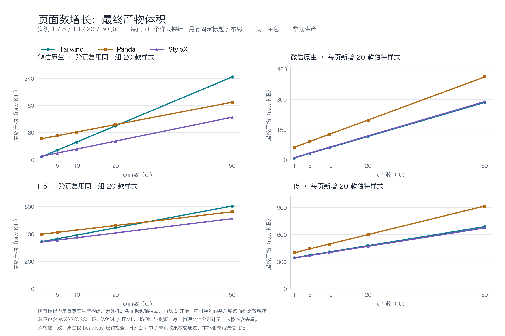

# 页面数增长补充实验

页面变多后，总量取决于“增加多少模板与绑定代码”和“新增多少样式定义”，并受适配器如何放置样式文件影响。这里把真实页面增加到 1、5、10、20、50 页，各做两种情况；所有点均为生产构建实测，没有外推到更大页数。



[SVG 矢量图](page-growth.svg) · [WXSS/CSS 曲线 PNG](style-growth.png) · [WXSS/CSS 曲线 SVG](style-growth.svg) · [原始 JSON](results.json) · [项目 CSV](results.csv) · [逐文件 CSV](files.csv)

## 怎么读这组数据

- **跨页复用**：所有页面复用同一组 20 款探针样式。Panda、StyleX 实际从共享模块导入样式定义；Tailwind 使用静态 WXML 类。
- **逐页独特**：每增加一页就新增 20 款探针样式，数值在编译期生成。两组第 1 页相同。
- 每页有 20 个变量样式探针，另有固定标题节点与布局根节点，合计 22 个受检节点。它们是真实的独立页面和编译期声明，未用运行时列表重复充当页面增长。
- 3 套方案 × 2 个目标 × 2 种增长模式 × 5 个页面数，共 60 个项目；仅用常规生产配置，全部页面处于同一主包，未混入分包拆分因素。

总量按最终物理文件计数，不按相同内容去重。单位为 raw KiB（1 KiB = 1024 B）；生产构建启用 minify、关闭 sourcemap，原生 WXSS 再统一用 LightningCSS 压缩。gzip level 9、Brotli quality 11 的逐文件压缩求和保存在 JSON/CSV，仅供传输压缩参考，不是微信官方上传包大小。

H5 的样式可能内嵌于 JS（如 ShadowRoot 样式），因此不能只看独立 CSS 文件判断 H5 的样式成本。完整产物总量是主要指标。

## 实测总量

### 微信原生：跨页复用（raw KiB）

| 页面数 | Tailwind | Panda | StyleX |
| --- | --- | --- | --- |
| 1 | 9.36 | 62.45 | 10.68 |
| 5 | 28.53 | 71.15 | 20.18 |
| 10 | 52.48 | 82.12 | 31.91 |
| 20 | 100.39 | 104.06 | 55.35 |
| 50 | 244.12 | 169.89 | 125.70 |

### 微信原生：逐页独特（raw KiB）

| 页面数 | Tailwind | Panda | StyleX |
| --- | --- | --- | --- |
| 1 | 9.36 | 62.45 | 10.68 |
| 5 | 32.35 | 91.35 | 34.16 |
| 10 | 60.43 | 126.94 | 62.52 |
| 20 | 116.61 | 198.12 | 119.21 |
| 50 | 285.14 | 411.65 | 289.29 |

### H5：跨页复用（raw KiB）

| 页面数 | Tailwind | Panda | StyleX |
| --- | --- | --- | --- |
| 1 | 344.53 | 398.87 | 342.13 |
| 5 | 365.72 | 412.14 | 355.98 |
| 10 | 392.20 | 428.74 | 373.29 |
| 20 | 445.15 | 461.97 | 407.94 |
| 50 | 603.91 | 561.70 | 511.93 |

### H5：逐页独特（raw KiB）

| 页面数 | Tailwind | Panda | StyleX |
| --- | --- | --- | --- |
| 1 | 344.53 | 398.87 | 342.13 |
| 5 | 373.61 | 443.30 | 369.69 |
| 10 | 408.61 | 495.84 | 403.54 |
| 20 | 478.62 | 600.98 | 471.24 |
| 50 | 688.55 | 916.43 | 674.33 |

## 从 1 页增长到 50 页

最后一列是 `(50 页总量 - 1 页总量) / 49`，只描述本区间平均增量，不作为每页固定成本或超过 50 页的预测。

| 目标 | 模式 | 方案 | 1 页 KiB | 50 页 KiB | 新增 KiB | 平均 KiB/新增页 |
| --- | --- | --- | --- | --- | --- | --- |
| 微信原生 | 跨页复用 | Tailwind | 9.36 | 244.12 | 234.76 | 4.79 |
| 微信原生 | 跨页复用 | Panda | 62.45 | 169.89 | 107.44 | 2.19 |
| 微信原生 | 跨页复用 | StyleX | 10.68 | 125.70 | 115.02 | 2.35 |
| 微信原生 | 逐页独特 | Tailwind | 9.36 | 285.14 | 275.78 | 5.63 |
| 微信原生 | 逐页独特 | Panda | 62.45 | 411.65 | 349.20 | 7.13 |
| 微信原生 | 逐页独特 | StyleX | 10.68 | 289.29 | 278.62 | 5.69 |
| H5 | 跨页复用 | Tailwind | 344.53 | 603.91 | 259.38 | 5.29 |
| H5 | 跨页复用 | Panda | 398.87 | 561.70 | 162.82 | 3.32 |
| H5 | 跨页复用 | StyleX | 342.13 | 511.93 | 169.80 | 3.47 |
| H5 | 逐页独特 | Tailwind | 344.53 | 688.55 | 344.02 | 7.02 |
| H5 | 逐页独特 | Panda | 398.87 | 916.43 | 517.56 | 10.56 |
| H5 | 逐页独特 | StyleX | 342.13 | 674.33 | 332.20 | 6.78 |

## 50 页分类明细（raw KiB）

按文件扩展名分类；H5 内嵌 CSS 仍计入 JS。WXS 归入脚本，WXML/HTML 归入模板。

| 目标 | 模式 | 方案 | WXSS/CSS | JS/WXS | WXML/HTML | JSON | 资源 | 总量 |
| --- | --- | --- | --- | --- | --- | --- | --- | --- |
| 微信原生 | 跨页复用 | Tailwind | 4.42 | 0.45 | 237.35 | 1.90 | 0.00 | 244.12 |
| 微信原生 | 跨页复用 | Panda | 37.75 | 25.79 | 104.44 | 1.90 | 0.00 | 169.89 |
| 微信原生 | 跨页复用 | StyleX | 5.26 | 7.94 | 110.60 | 1.90 | 0.00 | 125.70 |
| 微信原生 | 逐页独特 | Tailwind | 45.13 | 0.45 | 237.66 | 1.90 | 0.00 | 285.14 |
| 微信原生 | 逐页独特 | Panda | 81.25 | 224.05 | 104.44 | 1.90 | 0.00 | 411.65 |
| 微信原生 | 逐页独特 | StyleX | 39.65 | 137.14 | 110.60 | 1.90 | 0.00 | 289.29 |
| H5 | 跨页复用 | Tailwind | 4.51 | 599.07 | 0.33 | 0.00 | 0.00 | 603.91 |
| H5 | 跨页复用 | Panda | 21.12 | 540.25 | 0.33 | 0.00 | 0.00 | 561.70 |
| H5 | 跨页复用 | StyleX | 0.21 | 511.39 | 0.33 | 0.00 | 0.00 | 511.93 |
| H5 | 逐页独特 | Tailwind | 45.22 | 643.00 | 0.33 | 0.00 | 0.00 | 688.55 |
| H5 | 逐页独特 | Panda | 96.87 | 819.23 | 0.33 | 0.00 | 0.00 | 916.43 |
| H5 | 逐页独特 | StyleX | 0.21 | 673.79 | 0.33 | 0.00 | 0.00 | 674.33 |

## 观察到的趋势

**复用样式时，样式库的固定成本会逐渐被摊薄，总量仍随模板、页面注册与绑定代码增长。** 微信原生复用组的 1→50 页平均新增量为 Tailwind 4.79 KiB/新增页、Panda 2.19 KiB/新增页、StyleX 2.35 KiB/新增页。三方案同期全部 WXSS 的增量分别为 Tailwind 0.00 KiB、Panda 0.00 KiB、StyleX 1.34 KiB。模板类名长度、样式引用包装与实际绑定代码开销不同，因此不能只根据首屏或单页大小判断多页应用的最终总量。

**每页持续增加独特值时，还要支付新增样式规则和绑定数据的成本。** Tailwind 的原子声明仍能复用部分已有声明；Panda 的本地样式绑定随每页定义增加；StyleX 在 H5 的样式负载部分进入 JS。这些开销都保留在产物中。H5 还包含同一 weapp-vite Web renderer 的固定运行时代价，随着页面变多，各方案页面源码、模板与样式交付方式的差异逐渐体现。

**原生 StyleX 独特组的分段增量应与物理输出一起看。** 其总量在 1→5 页区间平均新增 5.87 KiB/页，20→50 页区间为 5.67 KiB/页；两个区间接近，未观察到旧版显著变陡的形状。这仅描述两个已测区间，不预测更大页数，也不将总量变化全部归因于 WXSS。

weapp-stylex@0.3.2 / weapp-vite@7.8.0 的当前输出如下。StyleX 命名文件按路径末尾的 `stylex*.wxss` 识别；这不是全部样式负载的定义，完整分类仍包含所有 WXSS。

| 50 页模式 | 全部 WXSS 文件数 | 全部 WXSS KiB | StyleX 命名文件数 | StyleX 命名文件 KiB | 同 SHA-256 最大副本数 |
| --- | --- | --- | --- | --- | --- |
| 跨页复用 | 52 | 5.26 | 1 | 3.76 | 1 |
| 逐页独特 | 52 | 39.65 | 1 | 38.15 | 1 |

两组均只检测到 1 个 StyleX 命名的 WXSS 文件，旧版“每页复制全局并集”的 51 副本形状未再出现。页面导入包装及其他 WXSS 仍全部计量；共享样式文件所在路径与页面引用由静态引用检查验证。 文件路径、SHA-256 与大小可在 [files.csv](files.csv) 复核。不能将本次布局外推为所有 StyleX 适配器或其他版本的行为。

## 验证与边界

60 个项目均完成两次清理后的生产构建，逐文件路径与 SHA-256 一致；真实构建产物的静态引用检查通过。报告生成器要求完整矩阵、逐行通过状态、全局验证通过及清单加总一致；同时核对 JSON/CSV 一致、持久化验证记录一致、截图路径及非空文件、输入源码指纹和测试资源关闭状态。失败或缺格会拒绝生成，也不会使用旧结果填补。

- **微信原生**：headless 对每个项目的全部页面检查逻辑 WXML、类名绑定和预期节点/状态；共 516 个页面检查。它不提供微信原生视觉渲染证据。[headless 原始记录](evidence/headless/report.json)。
- **H5**：每个项目的首、中、末页在 375/768 px 视口与实际手写 CSS 参考产物比较计算样式、布局尺寸；375 px 保存截图并进行逐像素比对，通过的三套方案观察点均无差异。1 页项目去重后只检查该页。768 px 保留计算样式/尺寸快照摘要，没有单独保存截图。[H5 原始记录与截图索引](evidence/web/report.json)。
- **IDE**：本补充实验没有新增微信开发者工具验收，不把原基准的代表页面 IDE 证据当作 50 页实验的逐页视觉验收。

本图只覆盖上述真实页面形状、20 个样式探针/页、同一主包和锁定版本。真实业务的组件复用比例、样式独特值数量、分包布局、绑定粒度与适配器升级都会改变曲线。连线仅连接测量点，各面板纵轴独立且从 0 开始；不应按跨面板线条角度比较增长速度。

## 版本与复现

Node 24.22.1、pnpm@12.16.1；weapp-vite 7.8.0；weapp-tailwindcss 5.6.3 + Tailwind 4.3.4；weapp-pandacss 2.3.0 + Panda 2.5.0；weapp-stylex 0.3.2。详细环境、配置及双轮文件清单在 [results.json](results.json) 中。

在仓库根目录执行（使用锁定工具链）：

```sh
corepack pnpm install --frozen-lockfile
pnpm exec node src/experiments/page-growth.mjs --concurrency=3
pnpm exec node src/experiments/validate-page-growth.mjs
pnpm exec node --test src/experiments/page-growth.test.mjs src/experiments/report-page-growth.test.mjs
pnpm exec node src/experiments/report-page-growth.mjs
pnpm exec node src/experiments/report-page-growth.mjs --check
python3 -m pip install -r src/experiments/requirements-chart.txt
python3 src/experiments/plot-page-growth.py
```

效果验证使用后台浏览器并在结束时关闭本任务创建的 browser/server；无需启动微信 IDE。图表使用 matplotlib 与中文字体，详见绘图脚本的 `--font` 参数。原始测量数据、本文表格和曲线来自同一份 `results.json`，本补充实验独立于原有 `pnpm bench` 矩阵。
